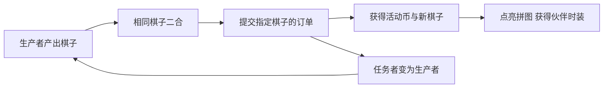

# 《时尚百货城》与 FFA／《菲菲大冒险》产品分析

调研日期：2026 年 10 月 14 日。依据：官方产品页、商店介绍、官方活动与帮助资料、行业收入报道。未进行实机长期体验；以下明确区分公开事实与设计判断。

## 1. 产品身份与分类

用户已确认 FFA 与《菲菲大冒险》为同一款产品，本次按两款独立产品分析。

| 项目 | 时尚百货城 | FFA／菲菲大冒险 |
|---|---|---|
| 产品身份 | 深圳市爱的番茄科技有限公司；大陆 iOS ID 6752632961 | Family Farm Adventure；Century Games／点点体系；海外 iOS ID 1543158709 |
| 主要玩法 | 放置百货经营、伙伴养成、换装、家装 | 农场种植加工、订单、消耗体力探索岛屿、任务剧情 |
| 二合的位置 | 已确认是主题活动的一部分 | 官方确认有 Sweet Merge 合成活动；该公告未单独说明二合规则 |
| 在前述调研中的归属 | 经营手游采用二合活动的案例 | 农场探索手游采用合成活动的案例 |
| 收入归类 | 整款经营产品收入，不能全归因于二合 | 整款农场探索产品收入，不能全归因于合成活动 |

来源：[时尚百货城官方商店页](https://apps.apple.com/cn/app/id6752632961)、[FFA 官方产品页](https://www.centurygames.com/games/family-farm-adventure/)、[时尚百货城官方“星途筑梦”公告](https://www.sina.cn/news/detail/5299299447477039.html)、[FFA 官方 Sweet Merge 公告](https://www.centurygames.com/family-farm-adventure-free-gift/)。

**研究价值：** 两款产品提示我们，合成除了作为主玩法，也可以作为经营游戏的活动模块。需要分别评估“整款游戏的商业表现”和“合成活动带来的增量”。

## 2. 时尚百货城：经营积累与时尚收藏结合

### 2.1 主循环与玩家目标

官方将游戏定位为百货经营手游，包含放置经营、伙伴培养、服装搭配与住宅装饰。玩家从小店扩张到更多店铺，招募伙伴并提升经营规模。[官方商店介绍](https://apps.apple.com/cn/app/id6752632961)。

依据这些系统，主循环可概括为：

**领取经营收益 → 投入店铺与伙伴成长 → 扩大经营能力／商业版图 → 获得更强的收益与解锁反馈。**

换装、伙伴和家装提供另一组目标：玩家既能追求经营数值，也能追求喜欢的形象、角色与场景。这里的女性向判断基于官方题材定位，不代表已核验玩家性别或年龄分布。

**设计分析：** 放置收益降低持续操作要求；经营升级带来稳定的长期目标；服饰和家装把抽象的成长变为可见收藏。三者是否能互相强化，取决于服装、伙伴和经营系统的实际关联，尚不能仅凭商店介绍确定所有属性效果。

### 2.2 二合活动：已确认的“星途筑梦”结构

2026 年 5 月 16 日官方公告明确介绍：相同棋子二合升级；生产者产出棋子；任务者接受指定棋子后可变为生产者；部分封锁格经合成解锁；暂存区保存奖励。订单奖励包含星途币、逐光币和新棋子，逐光币用于点亮伙伴时装拼图。[官方活动说明](https://www.sina.cn/news/detail/5299299447477039.html)。

可确认的循环是：

**值得拆解的设计：**

- **生产链发生变化。** 任务者交付后可转换成生产者，使目标不只是“将物品合到更高级”，还包括打开下一条供给路径。
- **操作奖励连接收藏目标。** 二合是活动内操作，伙伴时装是更长期的收集结果。活动奖励与主游戏主题具有一致性。
- **棋盘解锁提供局部成长。** 解锁格子和新生产者让活动内部也有推进感，即使主经营暂时停滞，仍有另一条目标可做。

以上是结构分析，不能直接证明活动提高留存或收入。还需确认棋子产出成本、活动体力来源、订单难度、限时周期，以及重复获得时装的用途。

### 2.3 商业化：已知事实与待验证推断

**已知：** 商店标明 App 内购买；官方预约页面列出钻石、扭蛋券、分钟卡、经验书等资源。[商店](https://apps.apple.com/cn/app/id6752632961)、[官方预约页面](https://ssbhc.tomatogames.com/appointment)。预约奖励只证明资源存在，不能证明抽取规则或付费贡献。

**待验证的商业化假设：**

| 潜在需求 | 对应系统 | 必须验证的内容 |
|---|---|---|
| 加快经营成长 | 时间收益、店铺与伙伴升级 | 付费是否明显缩短成长等待，免费节奏是否顺畅 |
| 获取喜欢的收藏 | 时装、伙伴、装饰 | 获取方式、价格、重复品价值、是否关联经营属性 |
| 完成主题活动 | 棋盘订单、活动进度、时装拼图 | 免费完成率、最后阶段成本、付费道具的实际作用 |

**风险判断：** 经营、养成、换装和多活动同时存在，可能增加目标分散和资源理解成本。若二合活动比主经营更有即时反馈，玩家也可能主要玩活动，经营主线变成领取奖励的入口。这是需要验证的行为假设。

### 2.4 市场表现：2026 新品，不能塞进 2024—2025 榜单

TapTap 官方入驻页面列上线日期为 **2026 年 1 月 29 日**。因此在没有更早商业运营证据时，应按 2026 年产品分析，不能将其列为前两年收入领先产品。[TapTap 产品页](https://www.taptap.cn/app/783475)。

七麦数据被国元证券周报引用：2026 年 5 月 9 日中国 iOS 游戏畅销榜第 **15**，5 月 16 日第 **18**。这支持其曾取得较明显的 App 付费表现，但两个日期的榜位不是月度／年度收入，也不能换算具体流水。[周报原表](https://pdf.dfcfw.com/pdf/H3_AP202605201822472528_1.pdf?1779263488000.pdf=)。

本次未取得可核验的全年或月度收入金额，也未取得各模块收入占比。

## 3. FFA／菲菲大冒险：体力探索与农场供给形成循环

### 3.1 主循环：两种节奏互相补充

官方介绍确认：Felicia 与 Toby 探索岛屿、解决谜题和推进故事，同时种植、饲养动物、完成订单并恢复装饰农场。[官方产品页](https://www.centurygames.com/games/family-farm-adventure/)。

它有两种不同节奏：

| 循环 | 玩家操作 | 回报 |
|---|---|---|
| 农场经营 | 种植、收获、加工、交付订单 | 资源积累、生产成长、任务奖励 |
| 冒险探索 | 消耗体力清除障碍，推进地图任务 | 新空间、资源、剧情与探索奖励 |

帮助中心说明体力用于清除地图障碍；订单阶段奖励、任务、地图宝箱，以及将水果／糖果转化成体力等方式都可补充能量。该帮助页较旧，本文不引用其体力上限作为当前数值。[官方体力说明](https://centurygames.helpshift.com/hc/en/31-family-farm-adventure/faq/3086-how-to-get-more-energy/)。

**分析：** 农场提供可重复的积累，探索提供更明显的空间与故事变化。资源兑换体力把两侧连接起来，玩家的目标不仅是生产更多，而是推进到下一段地图内容。

### 3.2 与典型二合的关键区别

| 维度 | 典型二合手游 | FFA |
|---|---|---|
| 主要操作空间 | 有限格子棋盘 | 农场与探索地图 |
| 体力的主要用途 | 从生成器生产物品 | 清理地图障碍、推进探索 |
| 核心成本判断 | 合成等级、概率、棋盘空间 | 路径选择、障碍能量、生产等待与任务需求 |
| 进度的视觉表现 | 高级物品、装修与剧情解锁 | 路径打开、地图展开、农场修复与剧情推进 |
| 合成的角色 | 通常是持续主操作 | 可作为限时活动模块 |

**设计判断：** 两者都在售卖“继续推进的机会”，但 FFA 的推进更容易呈现为空间变化。地图关卡需要路径、任务、场景和奖励的配合，内容生产结构通常比复用一张合成棋盘更复杂；实际成本仍取决于工具和复用能力。

### 3.3 活动结构：合成是一种扩充体验的方式

官方 2025 年 3 月公告确认有 **Sweet Merge** 活动；当前帮助中心还有钓鱼、相册、卡牌交换、设计师等模块。[Sweet Merge 公告](https://www.centurygames.com/family-farm-adventure-free-gift/)、[官方帮助中心](https://centurygames.helpshift.com/hc/en/31-family-farm-adventure/)。

Sweet Merge 的这份公告没有给出棋盘规则，故不能凭活动名字将它认定为与 Gossip Harbor 完全相同的二合系统，也不能证明活动至今永久开放。

**分析：** 在农场生产或主地图等待时，小游戏可以提供替代目标；如果奖励回流主线，活动还可能增加主线资源价值。具体的资源连接必须逐活动检查，不能默认所有模块共享体力。

### 3.4 商业化：体力、通行证与官网充值

可确认的设计包括：

- 官方帮助中心明确说明可以购买体力来加快进度，并列出免费体力获取路径。
- 2024 年 12 月官方 Golden Pass 公告说明，购买者可一键收取部分动物和工厂产品，免费玩家也有临时体验；这说明通行证曾提供操作便利权益，当前版本需再次核验。[Golden Pass 公告](https://www.centurygames.com/family-farm-adventure-golden-pass/)。
- 官方官网商店支持购买 Farm Bucks，并说明可用于游戏内礼包和优惠。官网渠道存在意味着仅看 App Store／Google Play 收入可能低估总收入，但本次不知道官网销售占比。[官方商店](https://ffa.centurygames.com/)。

**付费动机分析：** 玩家接近剧情节点、地图目标或活动终点时，补充体力具有明确用途；通行证可以把多次参与转化为持续目标与便利。难点是让免费玩家始终有可推进的路径，否则体力系统会从节奏控制变成阻断体验。

### 3.5 近两年收入证据

| 时间 | 公开证据 | 口径与限制 |
|---|---|---|
| 2024 全年 | Mobilegamer 引用 AppMagic，FFA 收入约 **3,500 万美元** | 发布商收入估算，扣除 Apple／Google 平台份额；不包含广告、官网收入及中国第三方安卓生态 |
| 2025 年行业分析时点 | Naavik 引用 Sensor Tower，累计收入约 **2.12 亿美元** | 从上线至文章统计时点的累计金额，绝不是 2025 全年收入 |
| 2025 全年 | 本次未取得同口径可核验金额 | 不由累计值减去不同数据库历史值反推 |

来源：[Mobilegamer 2024 年报告](https://mobilegamer.biz/the-top-grossing-mobile-game-publishers-of-2024/)、[Naavik 点点产品组合分析](https://naavik.co/digest/century-games-4x-portfolio-strategy/)。上述数字是整款产品表现，不能归入 Merge-2 市场规模。

## 4. 横向判断：分别应该学什么

| 比较项 | 时尚百货城 | FFA／菲菲大冒险 |
|---|---|---|
| 主线吸引力 | 商业扩张、伙伴与个人形象 | 农场积累、岛屿探索与故事 |
| 主要成长反馈 | 收益、店铺、角色和收藏 | 生产体系、新区域与剧情 |
| 合成研究重点 | 二合订单如何产出主题收藏奖励 | 合成活动如何与农场探索目标连接 |
| 商业化研究重点 | 经营加速与收藏追求能否配合 | 体力供需、事件进度与通行证价值 |
| 内容能力要求，分析判断 | 店铺、伙伴、服装与活动棋盘 | 地图、路径、故事、农场与多种活动 |
| 优先验证风险 | 模块过多、活动挤占主线、收藏成本不清晰 | 能量阻断、活动疲劳、地图内容成本 |

对一个计划做二合的团队，我更建议从《时尚百货城》研究**二合与时装收藏的奖励连接**，从 FFA 研究**体力消耗如何对应可见的地图进度**。这两项可以分别试验，不需要在原型阶段同时搭建完整商城与农场探索体系。

## 5. 如何验证二合活动是否真正有效

看到整款产品畅销，不能直接推导二合活动成功。应当看以下增量：

1. **参与：** 活动入口曝光后，多少玩家真正开始并完成第一张订单。
2. **留存：** 通过随机分组或相近条件对照，观察回访是否改善；直接比较参加与未参加的玩家容易受到原有活跃度影响。
3. **主线：** 主经营／探索是否得到资源和参与回流，还是被活动挤占。
4. **付费：** 活动新增收入是否超过被替代的主线收入，并覆盖内容与奖励成本。
5. **体验：** 免费完成率、最终阶段成本、棋盘拥堵、活动退出后奖励保留情况。

建议实机优先记录《时尚百货城》一次二合活动的“产出 → 订单 → 活动币 → 时装”路径；FFA 则记录一次“农场资源 → 体力 → 清障 → 任务／地图奖励”路径。再比较同等游玩时间下的成长感与付费触点。

## 6. 对前一份市场调研的补充

这两款适合单列为“经营／探索产品使用合成副玩法”的案例，不进入纯二合核心产品收入排名。这里的分类仅为保持市场测算一致；作为设计竞品，它们具有直接参考价值。

数据仍待补齐：2025 年 FFA 同口径全年收入、《时尚百货城》2026 年收入、两款各模块贡献与实机活动规则。现有材料支持结构拆解，尚不足以评价投资回报或断言某个活动是收入增长原因。
