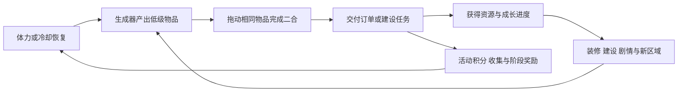

# 二合（Merge-2）手游 App 产品调研

调研日期：2026 年 10 月 14 日。年度回顾：2024—2025 年；趋势补充：2026 年上半年及 2026 年 3 月可核验快照。研究范围：中国大陆与海外的独立手游 App。

## 1. 核心结论

二合已经是值得投入的休闲手游方向，但头部竞争的核心是订单经济、外围成长、内容供给和持续活动运营。两个相同物品合成一个高等级物品只是入口。

- **海外／全球：收入增长和头部产品已得到验证。** Gossip Harbor、Travel Town、Seaside Escape 是 2024—2025 年的核心对标；2026 年 Tasty Travels 已进入领先阵营。
- **中国大陆：有可确认的 App 产品，公开市场总量和收入排名仍有缺口。** 本报告确认《浪漫餐厅》《肥鹅健身房》的大陆 App 身份，但不能据此给出它们的国内收入排名。
- **产品机会：** 剧情餐厅、订单小镇、庄园修复、烹饪配方、角色经营是五种有价值的拆解方向。后文的产品判断是基于公开玩法资料的分析，尚未进行实机长期体验或内部数据验证。

## 2. 研究边界与收入口径

本文重点研究“棋盘内生成物品 → 两个同级物品合成 → 交付订单／建设任务 → 解锁内容”的 Merge-2，尤其是有经营、建设或剧情外围的产品。三合、三消、2048、合成大西瓜不进入产品对标榜；微信／抖音小游戏不进入 App 市场总量。

需要区分三件事：

1. **地域：** 中国大陆收入、海外收入、全球收入是不同指标。中国公司开发的出海游戏，不能自动计入国内市场。
2. **收入：** 玩家支付流水、扣除税费／平台佣金后的净收入、上市公司确认的营业收入不能直接比较。第三方估算也不等于财务审计数据。
3. **分类：** “Merge／合成”常常包含二合与三合，不能把整个合成市场直接当作纯 Merge-2。

AppMagic 的报告主要覆盖 App Store 与 Google Play 的内购估算；其中国样本仅有 iOS，缺少国内第三方安卓商店。广告、官网商店和其他渠道收入也可能未被纳入。[AppMagic 2026 报告](https://appmagic.rocks/files/view/upload/Reports/EN_MobileMarkeLandscape2026.pdf)、[H1 2026 报告口径说明的二次整理](https://gamedevreports.substack.com/p/appmagic-mobile-casual-games-in-h1)。

本次未获得付费数据库的完整历史导出。因此下文给出“可核验领先产品与收入证据”，不伪装成同口径的完整两年收入排行榜。

## 3. 市场规模与变化

| 范围／分类 | 周期 | 可核验数字 | 应怎样理解 |
|---|---|---|---|
| 全球 Merge 全分类，AppMagic | 2024 → 2025 | 图表约 11 亿 → 17 亿美元；报告标注增长约 55% | 包含其他合成子类；图表读数为近似值，不能用四舍五入数字反算精确增速 |
| 全球 Merge 全分类，Sensor Tower 数据被上市公司引用 | 2025 | 超过 24 亿美元，同比增长 95% | 与 AppMagic 的分类、收入估算可能不同；原始数据表未取得，不与前一行拼接 |
| Merge-2 with Complex Meta，AppMagic | 2024 | 收入同比 +106%，下载同比 +43% | 这是更贴近本报告的二合＋外围分类；公开帖没有给出全年绝对规模 |
| 全球 Merge-2，H1 2026 报告的二次整理 | 2025 H1 → 2026 H1 | 6.36 亿 → 12.4 亿美元 | 同一整理文另列全部 Merge 约 13 亿美元、同比 +74%；两个分类不能混为一谈 |
| 中国大陆 Merge-2 App | 2024、2025 | 未找到足以核验的公开总量 | 安卓、广告和 App／小游戏归属均需补齐，不能按全球份额随意估算 |
| 严格剔除中国大陆后的海外 Merge-2 | 2024、2025 | 本次未取得同口径绝对规模 | 上述全球规模仅作海外赛道量级参考，不将其改名为海外规模 |

来源：[AppMagic 2026 市场全景，报告页码 39—41](https://appmagic.rocks/files/view/upload/Reports/EN_MobileMarkeLandscape2026.pdf)、[赤子城 2025 年业绩公告对 Sensor Tower 的引用，页码 11](https://www.hkexnews.hk/listedco/listconews/sehk/2026/0326/2026032601933_c.pdf)、[AppMagic 对 2024 年复杂外围二合的官方总结](https://www.linkedin.com/posts/appmagicrocks_merge-2-with-complex-meta-the-year-of-liveops-activity-7291015091796234240-4_Bk)、[H1 2026 数据二次整理](https://gamedevreports.substack.com/p/appmagic-mobile-casual-games-in-h1)。

**判断：** 公开证据足以支持“二合是增长较快、已形成较大收入规模的手游赛道”；尚不足以支持一个覆盖中国安卓、广告和全部海外渠道的统一市场总额。H1 数字不直接乘二当作全年预测。

## 4. 近两年收入领先产品：全球／海外对标

### 4.1 2024—2025 年核心阵营

表格顺序是研究优先级。除明确写出的名次外，不代表完整年度收入排序。

| 产品 | 厂商 | 2024 年证据 | 2025 年证据 | 证据限制 |
|---|---|---|---|---|
| Gossip Harbor: Merge & Story（浪漫餐厅） | Microfun／柠檬微趣 | 年末月收入超越 Travel Town；不能据此断言 2024 全年第一 | AppMagic 报告列全球年收入约 **5.5 亿美元**，合成市场占比约 33% | 全球估算；大陆版另有 App ID，不能视作大陆版收入 |
| Travel Town – Merge Adventure | Magmatic／Moon Active | 当年核心领先产品，年末被 Gossip Harbor 超过 | AppMagic 2026 报告仍将其列入重点头部产品 | 本次没有取得可单独确认地域、口径的年度精确值 |
| Seaside Escape: Merge & Story（常译漫游小镇） | Microfun／柠檬微趣 | AppMagic 官方年度总结列为增长核心产品 | 2025 年 8 月仅 Google Play 净收入已超过 **600 万美元**，渠道合作方公开披露 | 单月、单商店，不是年度双端收入 |
| Merge Mansion | Metacore | 老牌头部，AppMagic 指出其被前三款产品挤下领先位置 | 2025 年 3 月发布的分析指出，其通过活动运营将收入提高约 50% | 这是阶段变化，不能写成 2025 全年增长 50% |
| Merge Cooking | Happibits | 行业媒体引述 Sensor Tower：全年约 **2,600 万美元** | 同一媒体：全年约 **9,100 万美元** | 二次引用，未取得原始历史导出，不与 AppMagic 净收入排序混用 |
| Tasty Travels: Merge Game（媒体常译食光旅行） | Century Games／点点互动体系 | 产品开始进入市场，尚非稳定头部 | 世纪华通 2025 年报称进入休闲二合前五 | 公司披露的排名，未附同口径完整收入表；2026 年的上升更明确 |

来源：[Naavik 对 2024 年末竞争变化的分析](https://naavik.co/digest/gossip-harbors-meteoric-rise-in-merge/)、[AppMagic 2026 市场全景](https://appmagic.rocks/files/view/upload/Reports/EN_MobileMarkeLandscape2026.pdf)、[Flexion 对 Seaside Escape 的公告](https://news.cision.com/flexion-mobile/r/flexion-signs-seaside-escape---a-top-50-grossing-game%2Cc4235938)、[AppMagic 对 Merge Mansion 的官方分析摘要](https://www.linkedin.com/posts/appmagicrocks_howmerge-mansion-increased-its-revenue-by-activity-7308047829174767616-gLE8)、[Merge Cooking 年度数字的媒体整理](https://enjoyglobal.net/detail/news/2026012001)、[世纪华通 2025 年报](https://static.cninfo.com.cn/finalpage/2026-04-30/1225261915.PDF)。

### 4.2 最新变化：Tasty Travels 不应漏看

AppMagic 官方 2026 年 3 月快照：Merge-2 月收入份额分别为 Gossip Harbor **48%**、Tasty Travels **10%**、Travel Town **9%**、Seaside Escape **7%**；Tasty Travels 已升至月收入第二。这是月度榜，不能替代 2025 全年榜。[AppMagic 官方披露](https://www.linkedin.com/posts/appmagicrocks_tasty-travels-merge-game-becomes-number-activity-7449790501819695105-MNHI)。

H1 2026 报告的二次整理进一步给出 Tasty Travels 半年收入约 **1.27 亿美元**、同比约 13 倍。该数字用于趋势观察，原始表未取得，置信度低于前述官方月度份额。[H1 2026 整理](https://gamedevreports.substack.com/p/appmagic-mobile-casual-games-in-h1)。

## 5. 中国国内：代表 App 与数据缺口

| 已确认大陆 App | 可核验身份 | 核心定位 | 2024—2025 国内收入结论 |
|---|---|---|---|
| 浪漫餐厅™-Gossip Harbor | 中国 App Store，App ID **6472696051**，开发者显示柠檬曲奇 | 美食订单＋餐厅装修＋情感／悬疑剧情 | 未获得两年大陆内购完整数据，不能赋予国内第一或海外同等规模 |
| 肥鹅健身房 | 中国 App Store，App ID **1579028465**，开发者北京豪腾创想 | 合成任务＋健身房建设＋肥鹅角色表现 | 同时存在小游戏形态，需要拆分 App 与小游戏收入；未取得两年大陆 App 收入 |

来源：[浪漫餐厅中国商店页](https://apps.apple.com/cn/app/id6472696051)、[肥鹅健身房中国商店页](https://apps.apple.com/cn/app/id1579028465)。商店评分数量和畅销位置随时间变化，不能当作收入排名证据。

**特别排除一个常见错误：** 青瓷披露《肥鹅健身房》2024 年收入约 **5,974 万元人民币**的段落，讨论的是其 2024 年 2 月在日本上线、由集团引进授权的产品业务。不能用它代表中国大陆 App 收入，也不能用它代表该产品全球总流水。[青瓷 2024 年业绩公告](https://www1.hkexnews.hk/listedco/listconews/sehk/2025/0327/2025032700842.pdf)。

国内完整收入榜需要固定大陆 App ID／安卓包名，分别取中国 iOS、国内安卓渠道、广告收入，再剔除小游戏与海外。对未披露渠道，不使用一个统一倍率强行外推。

## 6. 二合核心玩法：玩家实际在做什么

下面是这类产品的通用系统分析；具体数值、活动和订单算法因游戏版本而异。

玩家表面上是在拖动物品，实际在做三种选择：为哪个订单投入体力、保留什么物品占用棋盘、什么时候推进主线或活动。

| 系统 | 玩家感受 | 产品设计作用 |
|---|---|---|
| 物品链与新物品解锁 | 每几次操作都有发现 | 提供短周期反馈与收集目标 |
| 多种生成器与分支产出 | 需要选择生产路线 | 让订单成本不只取决于等级 |
| 有限棋盘与仓库 | 想保留，但空间不足 | 形成物品取舍和整理策略 |
| 简单／复杂订单交替 | 既有立即完成，也有长期目标 | 控制奖励节奏和资源消耗 |
| 体力与生产冷却 | 等待后回来继续 | 组织登录节奏，提供加速需求 |
| 装修／建设／剧情 | 合成带来可见的世界变化 | 解释重复操作的长期意义 |
| 限时活动与收集 | 主线之外有新目标 | 提供额外参与动机与礼包场景 |

纯二合链的数学成本呈指数增长：从一级起算，十级物品需要 **512 个一级物品**。这仅适用于每次严格二合、没有高等级掉落和加速的理论链，不能直接当作真实体力消耗。订单难度还由生成概率、分支物品、冷却和奖励决定。

## 7. 六款重点产品的玩法差异

### Gossip Harbor／浪漫餐厅：让订单成为看下一段故事的动力

**公开玩法：** 合成餐饮物品满足顾客需求，重建并装饰餐厅；单亲母亲的生活重建、餐厅危机和人物关系构成主线。国服与海外角色名称不同，不宜机械照搬。[中国商店官方介绍](https://apps.apple.com/cn/app/id6472696051)。

**循环：** 食品合成 → 交付订单 → 获得资源 → 装修与剧情推进 → 解锁下一阶段。

**分析：** 适合研究“玩家为什么要继续做订单”。装修让成长可见，人物悬念让玩家对下一章节形成期待。核心难点是把剧情奖励节奏与订单成本配合起来；只复制情绪化广告，很难判断留存是否成立。

**商业化观察：** AppMagic 活动报告称其在 2025 年第三季度已接近每月 100 次活动实例。这里包含重复、短时等活动，并非每月新增 100 种玩法。[AppMagic LiveOps 2025，页码 25](https://investgame.net/wp-content/uploads/2026/01/2026-01-15-LiveOps_Report_2025_EN.pdf)。

### Travel Town：把同一份订单进度接到多种奖励上

**公开玩法：** 使用对应生成器制作居民所需物品，合成后交付订单。官方帮助页说明订单可关联活动代币、星星及其他奖励；具体奖励随活动和版本变化。[官方订单说明](https://support.traveltowngame.com/hc/en-us/articles/4833678076434-What-are-Orders)。

**循环：** 生产与合成 → 居民订单 → 建设／活动进度 → 新生产与目标。

**分析：** 适合研究订单经济与奖励联动。一个动作同时推进几项奖励，会增加玩家对同一笔体力投入的价值感；要验证这种价值感是否真的提高完成率，而不是只增加界面负担。

### Seaside Escape：用海滨小镇重建扩大内容空间

**公开玩法：** 二合数百种物品，帮助失意明星 Rowan 和当地居民，重建海滨小镇并揭开秘密。[官方商店介绍](https://apps.apple.com/us/app/id6443755785)。

**循环：** 多种物品合成 → 完成任务 → 重建小镇 → 新区域与人物内容。

**分析：** 与餐厅相比，小镇题材更容易容纳多个行业、建筑和居民。适合研究长线内容如何持续扩展，以及多条生产链是否带来足够的差异体验。中文译名不等于已经确认大陆有对应独立 App。

### Merge Mansion：把合成物品直接用于空间修复

**公开玩法：** 合成所需物品完成任务，修复庄园与花园，逐步探索家族秘密。官方也介绍了限时事件、装饰奖励和排行榜。[官方商店介绍](https://apps.apple.com/gr/app/id1484442152)、[Metacore 产品介绍](https://metacoregames.com/games)。

**循环：** 合成工具／所需物品 → 完成修复任务 → 开放房间／区域 → 发现故事线索。

**分析：** 建设目标与合成结果连接更直接，适合研究“修复前后”的成就感。较长的物品链和任务等待可能影响中后期节奏；公开资料不足以断言其当前留存劣于订单型产品。

### Tasty Travels：用各地美食组织持续解锁

**公开玩法：** 合成食材与菜品，完成游客任务，开放新食谱和目的地，以世界美食和旅行作为内容框架。[官方商店介绍](https://apps.apple.com/us/app/id6471045672)。

**循环：** 合成食品 → 任务交付 → 食谱／目的地解锁 → 新一轮内容。

**分析：** 地域美食天然提供关卡主题、视觉变化和活动包装。适合研究新内容的预期如何支撑重复合成。收入快速增长不能单独证明玩法更优，还需要结合买量规模、付费留存和内容成本。

### Merge Cooking：增加“食材配方＋厨具加工”这一层

**公开玩法：** 合成食材，利用煎锅、烤箱等厨具加工菜品，服务顾客并装修不同主题餐厅。官方明确描述了多种烹饪设备。[官方商店介绍](https://apps.apple.com/us/app/id1643509748)。

**循环：** 生成与合成食材 → 通过厨具制作菜品 → 服务订单 → 餐厅与菜谱成长。

**分析：** 配方加工使玩家的规划不限于“同级物品合成到更高级”。这是较值得研究的机制差异，但需要实机确认配方、厨具、等待和棋盘占用怎样配合，防止新手复杂度过高。

### 国内补充：肥鹅健身房

**公开玩法：** 合成经营健身房，以肥鹅角色表现、卡牌与活动丰富体验。国内官方商店介绍确认合成与经营定位。[官方商店介绍](https://apps.apple.com/cn/app/id1579028465)。

**分析：** 优先看角色吸引力、场景表现和经营反馈，研究玩家是否因为喜欢角色而继续合成。需要分别体验 App 与小游戏版本，不能默认它们的活动、付费和体验完全一致。

## 8. 对新产品立项的建议

以下是研究判断，不是已经被数据证实的收益预测。

| 方向 | 可研究的差异 | 优先验证的问题 |
|---|---|---|
| 剧情餐厅 | 更清晰的人物目标、章节悬念 | 玩家是否主动期待下一章节，订单是否成为过重门槛 |
| 旅行美食 | 地区菜谱、城市视觉与收藏 | 新主题是否提高持续游玩，而不只是增加美术成本 |
| 角色经营 | 角色动作、空间布置与养成 | 角色喜爱是否转化为回访和长期留存 |
| 配方烹饪 | 食材用途选择、厨具加工 | 是否增加策略而不损失二合的易上手优势 |

建议先验证“合成反馈 → 订单目标 → 外围奖励”能否独立成立，再扩大活动运营。优先拆解 **Gossip Harbor 的剧情节奏、Travel Town 的订单联动、Tasty Travels 的内容扩展**；Merge Cooking 用来观察机制差异，肥鹅健身房用来观察国内题材和角色表现。

最小研究记录应包括：首次会话结束位置、生成器／合成链解锁顺序、订单成本与奖励、棋盘拥堵时点、首次体力耗尽、首次付费触点、前三天剧情／建设奖励。进入商业化验证后再看 D1／D7／D30、付费率、LTV、获客成本与回收周期；本报告没有这些产品的内部指标，故不提供未经验证的行业目标值。

## 9. 仍待补齐的数据

- 2024、2025 及 2026 YTD 的同一数据库 Merge-2 分类导出，按大陆／海外和商店拆分。
- 各产品同周期全年收入，明确玩家流水或净收入，分离年度、月度和累计数。
- 国内安卓与广告收入，以及同名 App／小游戏间的渠道归属。
- 最新版本实机体验，尤其是订单算法、生成器产出与活动联动。

本版可用于赛道初筛与竞品拆解；涉及预算和市场份额测算时，需要补齐上述同口径数据。
